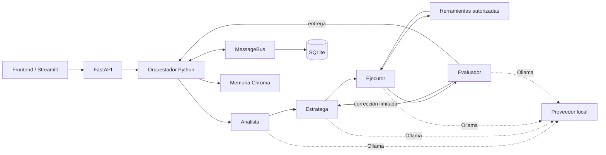

# Arquitectura

## Capas

1. `frontend/` ofrece el Dashboard web; `app.py` ofrece una vista Streamlit cliente.
2. `api/main.py` sirve la UI, crea sesiones y expone estado, mensajes, modelos, herramientas e historial.
3. `nexo/core/orchestrator.py` dirige fases y reintentos; `StateManager` mantiene estado en ejecución.
4. `nexo/agents/` implementa los cuatro agentes y contratos de mensajes.
5. `nexo/providers/base_provider.py` enlaza Ollama real o `MockProvider` explícito.
6. `MessageBus` guarda mensajes/eventos en SQLite; `nexo/core/memory.py` usa Chroma para recuerdos aprobados.

## Configuración

Los modelos y el endpoint se centralizan en `nexo/config.py`. El Orquestador no genera texto con un LLM propio. Ollama fuera de servicio produce un error explícito; `MockProvider` solo se usa si se configura como `mock`.

## Persistencia

SQLite conserva sesiones y registros operativos. Chroma almacena experiencias aprobadas para búsqueda semántica; memoria recuperada sirve como contexto, no como evidencia de la misión actual.
