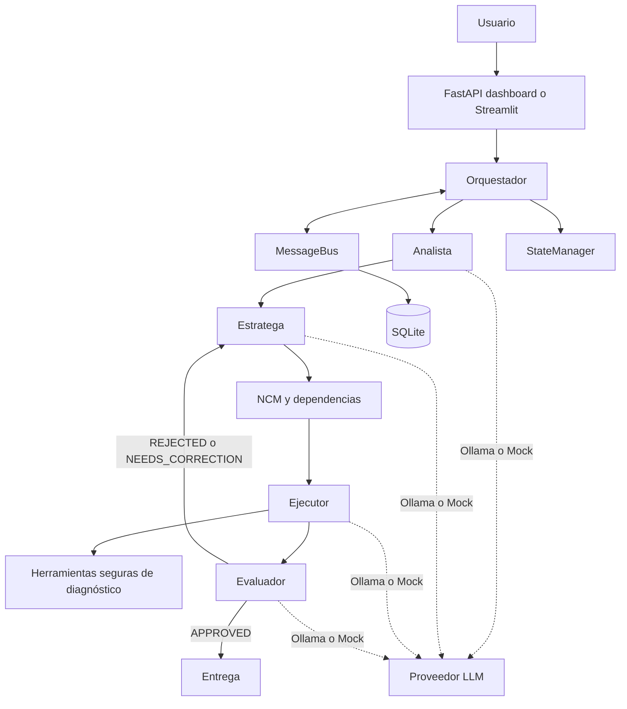

# Arquitectura de NEXO

NEXO es un sistema multiagente jerárquico. FastAPI recibe misiones; el Orquestador Python controla fases y estado; cuatro agentes intercambian `NexoMessage` por un bus en memoria con persistencia SQLite. Los modelos producen análisis y texto estructurado, mientras que las herramientas autorizadas consultan el entorno.

## Capas

1. **Interfaz:** dashboard en `frontend/` servido por `api/main.py`, o aplicación Streamlit en `app.py`.
2. **API:** endpoints REST para crear sesiones, consultar estado, mensajes, herramientas, coherencia y modelos.
3. **Coordinación:** `Orchestrator` y `StateManager` en `nexo/core/` controlan fases, dependencias, reintentos y fin de sesión.
4. **Agentes:** clases `BaseAgent` especializadas en `nexo/agents/` procesan el mensaje y devuelven otro mensaje.
5. **Proveedor:** `BaseLLMProvider` abstrae Ollama real y un `MockProvider` determinista.
6. **Herramientas y almacenamiento:** `ToolRegistry` gobierna diagnósticos; `MessageBus` persiste trazas en SQLite; Chroma almacena recuerdos textuales en la interfaz Streamlit.

## Separación de responsabilidades

- **StateManager** guarda el estado rápido de una sesión mientras vive el proceso. La base SQLite aporta trazabilidad durable.
- **MessageBus** entrega mensajes dentro de un proceso y los persiste; no coordina workers de máquinas distintas.
- **Orchestrator** es lógica explícita Python, no otro agente LLM. `ORCHESTRATOR` aparece en configuración por compatibilidad/previsión.
- **NCM** observa coherencia y recomienda replanificar; no reemplaza la evaluación de cumplimiento.
- **MockProvider** permite pruebas repetibles sin inferencia. Una respuesta mock nunca cuenta como verificación de Ollama real.

## Configuración

`nexo/config.py` fija valores predeterminados por rol y permite cambiar modelos y conexión con variables de entorno. `NEXO_MAX_ITERATIONS` y `NEXO_MAX_REPLANNING` son límites distintos. `NEXO_DB_PATH` configura SQLite. El Orquestador permite inyectar un diccionario de proveedores para sesiones de Streamlit y tests. Una configuración Ollama no se degrada a respuestas ficticias si falta el servicio.

## Dos caminos de Streamlit

«Equipo multiagente» llama `ejecutar_mision_completa()` y ejecuta el pipeline de la API. «Ejecutor con herramientas» llama `ejecutar_mision_directa()`; usa LangChain, archivos y Python, y no pasa por Analista/Estratega/NCM. El dashboard web usa siempre la API multiagente.
